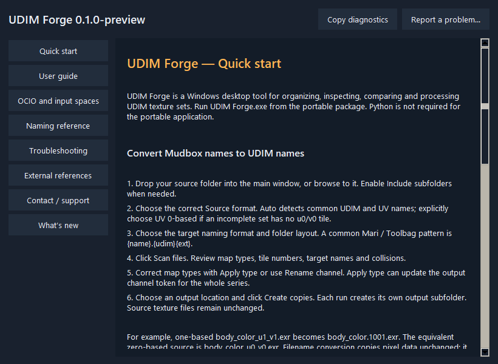

# UDIM Forge

A Windows desktop toolkit for UDIM texture sets: organize names and folders, inspect native pixels, compare A/B/C/D versions, validate assets and export processed copies.

This Git repository contains documentation, changelog and issue templates. Application source and EXE files are not committed to Git. Portable binaries are attached to **GitHub Releases**.

## Download

[Download UDIM Forge 0.3.1 — Windows x64 portable](https://github.com/Forge-Plugins/UDIM-forge/releases/download/v0.3.1/UDIM_Forge_v0.3.1_Windows_x64_Portable.zip) · [Latest release](https://github.com/Forge-Plugins/UDIM-forge/releases/latest) · [Changelog](CHANGELOG.md)

Extract the ZIP and run **UDIM Forge.exe**. No Python installation is required. GitHub’s automatic source archives contain documentation only. The release includes SHA256SUMS.txt. Inside the app, use **Help & Support → Check for updates…** to check the stable channel and open the portable download.

## Documentation

- [Production workflows](docs/production.md) — image formats, queues, recipes, displacement, HTML and .tx.
- [Quick start](docs/quick-start.md) — first conversion, inspection and comparison.
- [User guide](docs/user-guide.md) — complete workflows, controls and limitations.
- [OCIO and input assignments](docs/ocio.md) — color spaces per set/type and session-local policies.
- [Naming reference](docs/naming.md) — UDIM, UV coordinates, templates and channel naming.
- [Troubleshooting](docs/troubleshooting.md) — previews, large files, cache, colors and recovery.
- [External references](docs/references.md) — official format and pipeline documentation.
- [Contact / support](docs/support.md) — reporting problems and copying diagnostics.
- [Downloads and updates](docs/updates.md) — portable installation and manual update checks.
- [Changelog](CHANGELOG.md) — released changes and included workflows.

The application includes these guides offline in **Help & Support**. Its UI and documentation are in English.

## New in 0.3.1

- Main-window per-map resolution limits, an 8K Displacement / 4K Normal / 2K Color preset, custom pixel sizes and filter selection.
- One Start conversion applies names, formats and resolutions. Aspect ratio is preserved without upscaling; resized normals are renormalized.
- Resolution rules save in profiles/settings, including custom types through All map types. [Guide](docs/production.md#resolutions-by-map-type-in-the-main-window).

## Added in 0.3.0

- Main-window per-map formats: Displacement EXR float32, Normal PNG16 and Color PNG8 in one Start conversion; profile persistence and custom types.
- Fixed cross-drive publishing (WinError 17), recoverable prepared outputs and a working Cancel current work action for queue/native TX tasks.
- TX CPU/compression tuning and right-click multi-selection format/resolution edits in preview and paused unfinished jobs.

## Added in 0.2.1

Select **Output image format / bit depth** directly in the main window, then **Start conversion** to apply UDIM naming, folder layout and actual EXR/PNG/TIFF/JPEG encoding in one operation. Compression and Alpha are beside the format selector. Preview shows final extensions and collisions; settings save in profiles. **Keep original format** retains byte-identical copying when resizing is disabled.

## Added in 0.2.0

**Start conversion** handles naming/layout and the main-window image encoding selection. For true EXR/PNG/TIFF/JPEG encoding use **Convert image format… → Preview export plan → Start format conversion**, with bit depth, compression and Alpha controls. The main file table now scrolls horizontally.

- Persistent processing queue with resume, dependencies, parallel workers and a hard queue memory cap.
- Per-map recipes for whole sets; shared displacement transforms with inverse sidecars.
- Quality findings, offline HTML A/B reports and tiled/mipmapped .tx export.
- Explicit baked OCIO exports for Color, separate from ordinary preview.
- Persistent error logs, reviewed/redacted diagnostic ZIPs and moved-project relinking with content-verified analysis.

See the [production guide](docs/production.md), [relink/support instructions](docs/support.md) and [changelog](CHANGELOG.md).

## Main workflows

- Mudbox UV/UDIM naming conversion and whole-set channel renaming, with new output copies.
- Native RGBA sampling, histogram/min/max/ROI statistics and set validation.
- Up to four version folders with shared A/B zoom/pan, Wipe, differences, change highlights and CSV reports.
- Incremental comparison sessions, autosave, recovery history and source-change detection.
- Supported 8K/16K streaming and persistent PSD/PSB saved-composite cache preparation.
- Batch grading/map utilities, ORM/RMA packing and resizing with normal-map normalization.
- OCIO color viewing with input-space rules, while displacement/normal/data values remain native.

## Support

[Report a problem](https://github.com/Forge-Plugins/UDIM-forge/issues/new?template=bug_report.yml) or [request a feature](https://github.com/Forge-Plugins/UDIM-forge/issues/new?template=feature_request.yml). Search [existing issues](https://github.com/Forge-Plugins/UDIM-forge/issues) first. Use **Help & Support → Export diagnostics…** to review/export logs, or Copy diagnostics for version basics. Include the reviewed diagnostics and reproduction steps. Review attachments before posting publicly.

UDIM Forge was previously named UDIM Studio. Existing settings, profiles, reports, caches and comparison sessions remain compatible. Settings intentionally stay under `%APPDATA%\UDIM Studio`.
